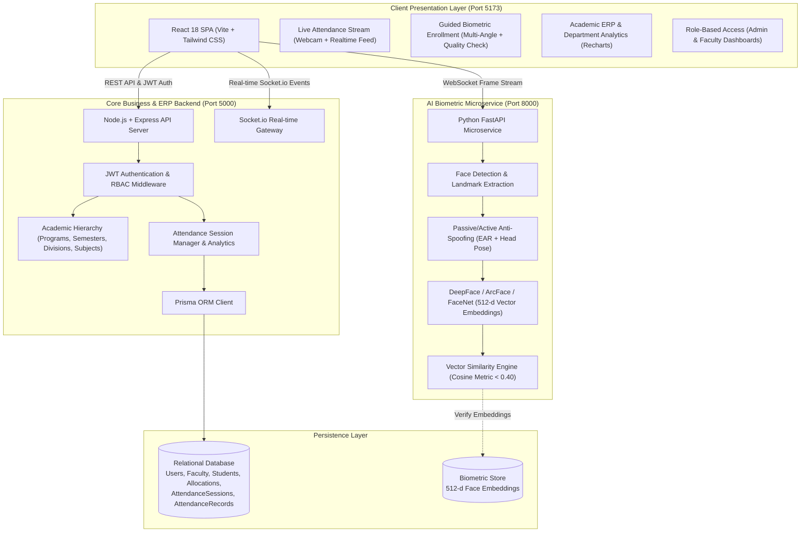

# SmartAttend — AI-Powered Smart Attendance ERP System

[](frontend/)
[](backend/)
[](ai-service/)
[](backend/prisma/)
[](frontend/)

**Enterprise-grade academic attendance management system combining real-time biometric facial recognition, multi-angle liveness detection, and academic ERP workflows.**

---

## 📌 System Architecture

SmartAttend is built on a high-throughput, decoupled microservice architecture:



---

## 🚀 Key Features & Capabilities

### 1. 🤖 Deep Biometric Recognition & Anti-Spoofing
* **512-Dimensional Deep Embeddings**: State-of-the-art face vector extraction yielding high identification accuracy and near-zero false-accept rate.
* **Two-Tier Liveness Detection**:
  * **Passive Blink Verification**: Eye Aspect Ratio (EAR) tracking to reject 2D photos, phone screen replays, and cutouts.
  * **Head-Pose Challenge**: 3D yaw/pitch orientation verification to prevent static spoofing attacks.
* **Multi-Angle Guided Enrollment**: Step-by-step guided capture (Straight, Left, Right, Tilt) with real-time blur and lighting validation.

### 2. 🏛️ Complete Academic Hierarchy & Scoping
* **Strict Division Scoping**: Classes, Semesters, Divisions (e.g., *B.Tech AIML - Div B*), and Subjects.
* **Faculty Allocations**: Faculty members are allocated specific subjects and divisions, preventing unauthorized attendance manipulation.
* **Scoped KPI Dashboards**: Student rosters, enrollment statuses (All, Done, Pending), and live attendance percentages dynamically adapt to selected division filters.

### 3. 🎨 Modern Obsidian Glassmorphism UI
* **Obsidian Midnight Dark & Crisp Slate Light Themes**: High-contrast, accessibility-tested color palettes.
* **Custom Modal Architecture**: Replaced browser `alert()` and `confirm()` prompts with responsive, glassmorphic confirmation dialogs.
* **User Profile Hub**: Faculty and Admins can view teaching allocations, assigned departments, security credentials, and biometric specs.

---

## 🛠️ Technology Stack

| Layer | Technologies |
|---|---|
| **Frontend** | React 18, Vite, Tailwind CSS, Lucide Icons, Recharts, Axios, Socket.io-client |
| **Backend API** | Node.js, Express, Prisma ORM, JSON Web Tokens (JWT), Bcrypt |
| **AI / Computer Vision** | Python 3.10+, FastAPI, Uvicorn, OpenCV, MediaPipe, DeepFace, ArcFace / FaceNet, NumPy |
| **Database** | Relational Database (PostgreSQL / MySQL / SQLite supported via Prisma) |

---

## ⚡ Quick Start & Startup Guide

For detailed step-by-step setup instructions, please see the **[Startup Guide (RUNNING_THE_PROJECT.md)](RUNNING_THE_PROJECT.md)**.

### Summary of Startup Commands:

#### 1. AI Service (Python FastAPI)
```bash
cd ai-service
# Activate your virtual environment (if using one)
python -m uvicorn app.main:app --host 0.0.0.0 --port 8000
```
> Running at: `http://localhost:8000` (Swagger docs: `http://localhost:8000/docs`)

#### 2. Core Backend (Node.js & Express)
```bash
cd backend
npm install
npx prisma db push
node src/server.js
```
> Running at: `http://localhost:5000`

#### 3. Frontend (React & Vite)
```bash
cd frontend
npm install
npm run dev
```
> Web Dashboard at: `http://localhost:5173`

---

## 🔐 Default Credentials

| Role | Email / Username | Password |
|---|---|---|
| **Admin** | `admin@college.edu` | `password123` |
| **Faculty** | `faculty@college.edu` | `password123` |

*(Credentials can be updated at any time in the Settings / Profile tab)*

---

## 📋 Academic Project & Viva Overview

| Evaluation Component | Technical Implementation Details |
|---|---|
| **Face Detection** | OpenCV / MediaPipe face ROI isolation and bounding box regression |
| **Anti-Spoofing & Liveness** | EAR (Eye Aspect Ratio) blink rate tracking + dynamic head pose yaw estimation |
| **Face Recognition Engine** | DeepFace 512-dimensional vector embedding extraction + Cosine Similarity matching |
| **Academic ERP Hierarchy** | Relational data model mapping Programs $\rightarrow$ Semesters $\rightarrow$ Divisions $\rightarrow$ Subjects $\rightarrow$ Faculty Allocations |
| **Full Cascade Deletion** | Complete cascade cleanup of student accounts, biometric embeddings, and attendance history |
| **Real-Time Synchronization** | WebSocket and Socket.io event pipes updating faculty monitors and dashboards with zero latency |
| **Security & RBAC** | Stateless JWT authentication, role guards (ADMIN vs FACULTY), and bcrypt credential hashing |

---

## 📄 License
This project is open-source under the [MIT License](LICENSE).
